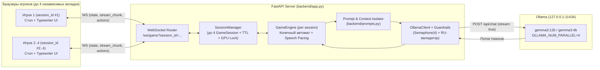
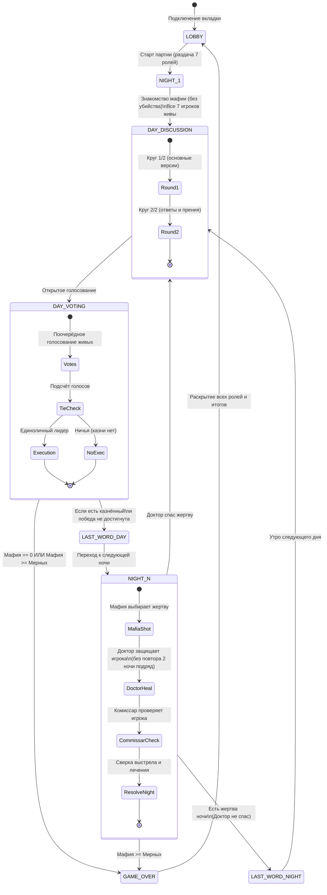
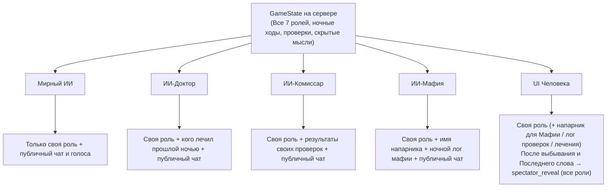

# План разработки и архитектура игры «Мафия AI» (Ollama)

## 1. Концепция и реализованные правила

Браузерная настольная игра **«Мафия»** для одного человека против 6 ИИ-соперников под управлением локального **Ollama** (рекомендуемые модели: `gemma3:12b` на GPU и `gemma3:4b` на CPU/GPU). Работает как локально (`localhost`), так и на удалённом сервере с поддержкой до **4 независимых параллельных партий**.

### Параметры и правила партии
- **Игроки за столом:** 7 мест (1 человек на случайном месте №1–7 + 6 ИИ с уникальными русскими именами и смешанным полом `М`/`Ж`).
- **Состав ролей:** **2 Мафии, 1 Комиссар, 1 Доктор, 3 Мирных жителя** (раздаются случайно в каждой партии).
- **Первая ночь без убийств:** в Ночь 1 мафия знакомится друг с другом в приватном логе без выстрела; День 1 всегда начинается в полном составе (7 живых игроков). Активные ночные действия (выстрел мафии, лечение Доктора, проверка Комиссара) начинаются с **Ночи 2**.
- **Ограничение Доктора:** Доктор не может лечить одного и того же игрока две ночи подряд.
- **Закрытая игра (`в закрытую`):** роли убитых ночью и казнённых днём **не раскрываются** ведущим до конца партии.
- **Регламент дня:** ровно **2 круга последовательных высказываний** (`Круг 1/2` — основные версии, `Круг 2/2` — ответы и прения) → открытое последовательное **голосование** на выбывание.
- **Последнее слово:** каждый выбывший игрок (жертва ночи или казнённый на голосовании) получает право на последнее слово, если партия не завершилась.
- **Режим наблюдателя:** при выбывании человека роли остаются скрытыми на время его последнего слова и **мгновенно раскрываются** (`spectator_reveal: true`) сразу после завершения/пропуска последнего слова.
- **Честная изоляция информации:** сервер формирует персональный контекст для каждой роли — мирные ИИ, Доктор и Комиссар физически не получают чужих ролей и ночного чата мафии.
- **Выбор модели в лобби:** динамически загружается список всех моделей из `GET /api/tags` (`ollama list`) с размером на диске. В серверном режиме активная модель фиксируется на время идущих партий (`SINGLE_GPU_MODEL_LOCK`), чтобы не выгружать веса из VRAM.

---

## 2. Технический стек

| Слой | Технология | Особенности реализации |
| :--- | :--- | :--- |
| **Backend** | Python 3.10+, **FastAPI**, `uvicorn` | Асинхронный сервер, middleware `Cache-Control: no-store` для мгновенного обновления статики, `SessionManager` на 4 стола |
| **Связь с LLM** | `httpx.AsyncClient` → Ollama `/api/chat` (`stream: True`) | Потоковый plain-text вывод без тяжёлого `format: "json"` (убрана задержка GBNF-грамматики на большом словаре Gemma), семафор `asyncio.Semaphore(MAX_SESSIONS)` |
| **Транспорт UI ↔ Backend** | **WebSockets** (`/ws/game?session_id=...`) | Изоляция сессий по `sessionStorage` вкладки, живые чанки (`stream_chunk`), обновления состояния (`state`), слоты (`slots`) и статус Ollama (`health`) |
| **Frontend** | Vanilla HTML5 + CSS3 + ES6 JS | Нуар-стол с овальным сукном, процедурные SVG-портреты, комикс-облачка с плавным посимвольным выводом (`45 мс/симв`, ~22 симв/сек) и хроника справа |
| **Деплой** | `systemd` (любой Linux-сервер) / `supervisor` + `cloudflared` (Vast.ai) | Готовые скрипты в `deploy/` с поддержкой `OLLAMA_NUM_PARALLEL=4`, автодокачки GGUF и HTTPS/WSS-туннеля |

---

## 3. Архитектурные схемы

### 3.1. Общая архитектура (мультисессионный сервер)



### 3.2. Конечный автомат игрового цикла (`GameEngine`)



### 3.3. Изоляция информации по ролям



---

## 4. Инженерия ИИ, валидация речи и темп игры

### 4.1. Быстрый стриминг и формат вывода (`backend/llm_client.py`)
- Вместо тяжёлого `format: "json"` используется потоковый plain-text вывод (`stream: True`) с общим системным префиксом для эффективного переиспользования KV-кэша в Ollama.
- Для реплик с выбором цели (голосование, выстрел мафии) используется двухстрочный формат `ПРИЧИНА` → `ГОЛОС` / `ЦЕЛЬ` с автосогласованием `reconcile_target_with_speech`, чтобы слова и выбранная цель никогда не противоречили друг другу.
- Для ночных ходов Доктора и Комиссара используется сверхкороткий режим `night_target` (выбор только имени цели без лишней генерации текста).

### 4.2. Защита качества и логики речи (Guardrails)
Реализованы проверки и автоповтор (`LLM_MAX_RETRIES`) + безопасный фоллбэк:
- **Чистота русского языка:** фильтрация CJK-иероглифов, лишней латиницы, мета-фраз про ИИ/промпты, обрезка оборванных хвостов (`trim_incomplete_tail`).
- **Логика стола:** запрет говорить о себе в 3-м лице и обращаться к себе по имени; запрет обвинять других в «молчании» (очерёдность строго последовательная); запрет обращаться к мёртвым как к живым (`_check_dead_player_misuse`); запрет приписывать аргументы игрокам, которые ещё не выступали сегодня (`_check_unspoken_player_hallucination`); запрет саморазоблачения мафии днём.
- **Ролевая тактика (`backend/prompts.py`, `backend/engine.py`):**
  - ИИ-Комиссар при нахождении мафии приоритетно вскрывается и голосует только в проверенную мафию.
  - Мирные ИИ не голосуют против единственного неоспоренного вскрывшегося Комиссара.
  - ИИ-Мафия не голосует в живого напарника при наличии мирных целей.

### 4.3. Плавная печать в облачке и удержание для чтения
На быстром GPU реплика генерируется за 0.5–1.5 сек, поэтому реализована синхронная двухслойная регулировка темпа:
1. **Frontend (`frontend/app.js`):** автомат печатной машинки выводит реплику посимвольно со скоростью `45 мс/симв` (~22 симв/сек) в комикс-облачке и в хронике без мерцания DOM (обновление `.comic-speech-text` на месте).
2. **Backend (`backend/engine.py`, `backend/config.py`):** после фиксации публичной реплики ИИ движок вычисляет оставшееся время печати (`len(speech) / SPEECH_CHARS_PER_SEC - already_elapsed`) и добавляет паузу на чтение `SPEECH_READ_HOLD_SEC = 2.2` сек, прежде чем передать слово следующему игроку. В юнит-тестах (`spectator_delay=0.0`) паузы автоматически отключаются.

---

## 5. Структура файлов проекта

```text
mafiaAI/
├── PLAN.md                      # Актуальная архитектура и статус реализации
├── README.md                    # Инструкции локального запуска, деплоя на любой сервер и Vast.ai
├── requirements.txt             # fastapi, uvicorn[standard], httpx, pydantic
├── run.py                       # Точка входа uvicorn (учитывает MAFIA_HOST / MAFIA_PORT)
├── backend/
│   ├── __init__.py
│   ├── config.py                # Профили CPU/GPU, лимиты сессий (4), темп речи и тайминги
│   ├── models.py                # Player, Role (4 роли), Gender, Phase, ChatMessage, GameState
│   ├── personas.py              # Генератор уникальных русских имён и полов
│   ├── prompts.py               # Изоляция контекста по ролям, прямые обращения, тактика ролей
│   ├── llm_client.py            # Async Ollama client, Semaphore(4), streaming, RU-валидатор
│   ├── engine.py                # Игровой цикл, Ночь 1 без убийств, Доктор/Комиссар, Last Word, pacing
│   ├── session_manager.py       # Изоляция до 4 GameSession, TTL-очистка, SINGLE_GPU_MODEL_LOCK
│   └── app.py                   # FastAPI, WebSocket /ws/game, /api/health, no-store middleware
├── frontend/
│   ├── index.html               # Лобби, графический стол, панель действий, хроника
│   ├── style.css                # Нуар-оформление, комикс-облачка, облачка мыслей, ночной режим
│   └── app.js                   # WebSocket-клиент, SVG-портреты, посимвольная печать (typewriter)
├── deploy/
│   ├── vast_setup.sh            # Автонастройка GPU-сервера: Ollama, supervisor, aria2c GGUF, cloudflared
│   └── deploy_to_vast.sh        # Доставка проекта по SSH и автономный запуск через supervisor
└── tests/
    └── test_mafia.py            # 8 автотестов: полная партия, изоляция ролей, 4 сессии, валидатор, темп речи
```

---

## 6. Статус этапов реализации

- [x] **Этап 1.** Каркас FastAPI + WebSockets + `OllamaClient` с потоковым `/api/chat` и RU-guardrails.
- [x] **Этап 2.** Полный ролевой состав на 7 мест (2 Мафии, Комиссар, Доктор, 3 Мирных), случайные имена/полы/места.
- [x] **Этап 3.** Жёсткая изоляция контекста по ролям, сжатие прошлых дней, тактика Комиссара/Доктора/Мафии.
- [x] **Этап 4.** Закрытая игра, Ночь 1 без убийств, 2 круга обсуждения, голосование, Последнее слово, режим наблюдателя.
- [x] **Этап 5.** Визуальный стол с SVG-аватарами, комикс-облачками (без мерцания), плавной посимвольной печатью и паузой на чтение.
- [x] **Этап 6.** Мультисессионность до 4 параллельных партий (`SessionManager`), GPU-профиль (`RTX 3060 12 GB`) и скрипты деплоя.
- [x] **Этап 7.** Покрытие ключевых механик юнит- и интеграционными тестами ([tests/test_mafia.py](tests/test_mafia.py) — 8/8 OK).
