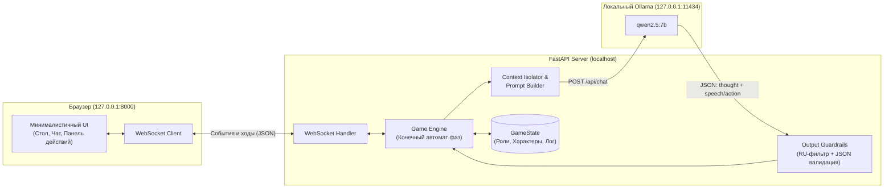
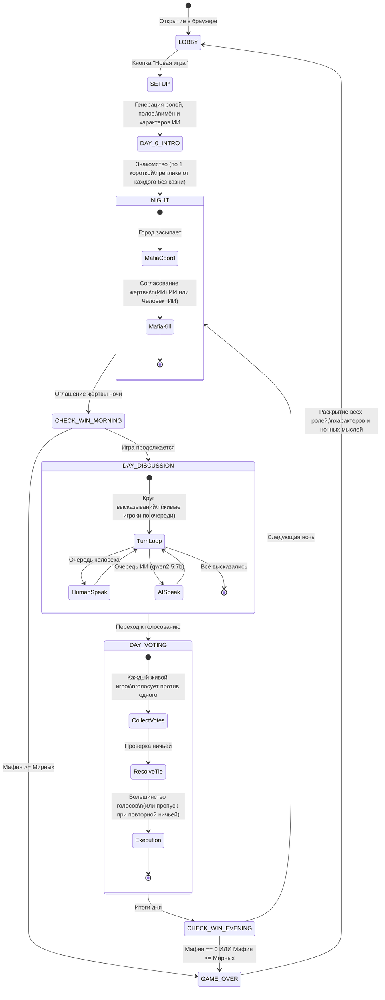
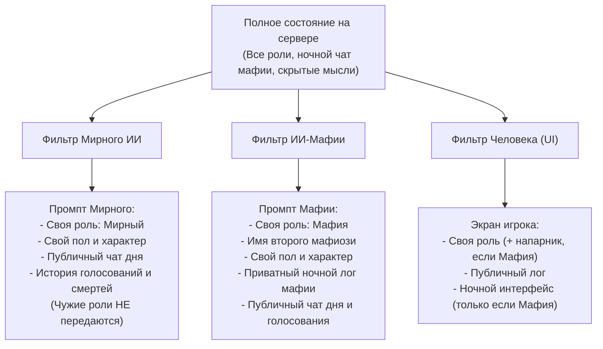

# План разработки и архитектура игры «Мафия с ИИ» (`qwen2.5:7b`)

## 1. Концепция и ключевые требования

Браузерная настольная игра «Мафия» для одного человека против 6 ИИ-соперников под управлением локальной модели **Ollama (`qwen2.5:7b`)**. Работает полностью локально (`localhost`).

### Параметры партии
- **Всего игроков:** 7 (1 человек + 6 ИИ).
- **Выбор модели ИИ перед игрой:** в лобби автоматически загружается список всех локальных моделей из Ollama (`GET /api/tags` / `ollama list`, например `qwen2.5:7b`, `qwen2.5:3b`, `qwen2.5:1.5b`, `gemma3:4b`, `mistral:7b`) с их размером на диске, чтобы игрок мог выбрать любую модель перед стартом партии.
- **Состав ролей:** 2 Мафии, 5 Мирных жителей (распределяются случайно перед началом каждой игры, включая человека).
- **Закрытый режим (в закрытую):** роли убитых ночью и казнённых днём **не раскрываются** ведущим до полного окончания партии (на финальном экране раскрываются все роли, характеры и скрытые мысли).
- **Регламент дня:** в каждый игровой день проходит ровно **2 круга высказываний** живых игроков (основное мнение + короткий круг ответов/реакций), после чего начинается обязательное голосование.
- **Личности ИИ:** в начале каждой новой партии каждому из 6 ИИ случайно назначаются:
  - **Пол** (`М` / `Ж`) и соответствующее русское имя (без повторов).
  - **Уникальный характер (архетип)** и манера речи из пула характеров (без повторов внутри одной партии).
- **Честное незнание ролей (жёсткая изоляция контекста):** ИИ не «притворяется», что не знает чужие роли — сервер физически не передаёт мирному ИИ информацию о чужих ролях, а мафии передаёт только имя её единственного напарника.
- **Языковые и ролевые ограничения:** только русский язык, только внутриигровой контекст за столом, запрет на мета-комментарии ИИ, иероглифы/англицизмы и выход из роли.
- **Графика:** минималистичный тёмный интерфейс с акцентом на читаемость диалогов, статусы игроков, голосование и темп игры.

---

## 2. Технический стек

| Слой | Технология | Обоснование |
| :--- | :--- | :--- |
| **Backend** | Python 3.10+, **FastAPI**, `uvicorn` | Легковесный асинхронный сервер, нативная поддержка WebSockets, простая интеграция с Python-окружением |
| **Связь с LLM** | `httpx` (AsyncClient) -> Ollama REST API (`http://127.0.0.1:11434/api/chat`) | Асинхронные запросы без блокировки цикла событий, поддержка JSON-режима (`format: "json"`) и удержания модели в памяти (`keep_alive`) |
| **Транспорт UI <-> Backend** | **WebSockets** (`/ws/game`) | Позволяет в реальном времени транслировать смену фаз, поочерёдные реплики ИИ и ожидание хода человека |
| **Frontend** | Vanilla HTML5 + CSS3 + JavaScript (ES6+) | Минимализм, нулевая сборка (без тяжёлых фреймворков), мгновенный запуск из статики FastAPI на `http://127.0.0.1:8000` |
| **Хранение состояния** | In-memory (объект сессии в памяти процесса) | Партия сессионная и локальная; при желании лог партии можно сохранять в локальный JSON |

---

## 3. Архитектурные схемы

### 3.1. Общая архитектура системы



### 3.2. Схема игрового цикла (State Machine)



### 3.3. Схема изоляции информации (Почему ИИ не знают чужих ролей)



---

## 4. Проектирование ИИ-игроков и контроль `qwen2.5:7b`

### 4.1. Генератор личностей (на каждую партию заново)
Перед стартом партии для 6 слотов ИИ случайно выбираются:
1. **Пол и имя:** мужской (`Алексей`, `Виктор`, `Дмитрий`, `Игорь`, `Максим`, `Роман`, `Сергей` и др.) или женский (`Анна`, `Елена`, `Марина`, `Ольга`, `Светлана`, `Татьяна`, `Юлия` и др.) — гарантируется грамматический род в системном промпте (`говори о себе в мужском/женском роде`).
2. **Уникальный характер (выборка 6 из 12+ без повторов):**
   - **Аналитик** — опирается на факты, кто за кого голосовал, ищет противоречия, спокоен.
   - **Импульсивный обвинитель** — быстро выбирает подозреваемого, давит, провоцирует на эмоции.
   - **Осторожный наблюдатель** — немногословен, избегает резких обвинений без улик, часто сомневается.
   - **Харизматичный манипулятор** — уверенный тон, пытается вести стол за собой и формировать коалиции.
   - **Параноик** — видит сговор в любых совпадениях и защите одного игрока другим.
   - **Скептик-иронист** — ставит под сомнение чужие аргументы, язвителен, но рассудителен.
   - **Эмоциональный интуит** — опирается на «ощущения» от тона реплик, ярко реагирует на обвинения в свой адрес.
   - **Миротворец** — пытается гасить хаос, просит не казнить поспешно, ищет консенсус.
   - **Упрямец** — если вцепился в версию, гнёт её до конца, тяжело меняет мнение.
   - **Конформист** — склонен присоединяться к уверенному большинству, боится остаться крайним.
   - **Детектив-буквоед** — цепляется к конкретным формулировкам из прошлых раундов.
   - **Дерзкий блефовщик** — не боится идти на конфликт, резко отвечает на подозрения.

### 4.2. Разделение «Мысли» и «Речи» (`thought` vs `speech`)
У моделей размера 7B есть классическая проблема в «Мафии»: если просить сразу реплику, ИИ-мафия может случайно проговориться или сыграть слишком плоско.
Решение — запрос строго в JSON-формате (`format: "json"` в Ollama):

- **Для дневной реплики:**
  ```json
  {
    "thought": "Внутреннее рассуждение (скрыто от стола): кто опасен, кого выгодно обвинить или прикрыть.",
    "speech": "Реплика вслух на русском языке (1-3 предложения, строго в характере)."
  }
  ```
- **Для голосования / ночного выстрела:**
  ```json
  {
    "thought": "Почему я выбираю эту цель.",
    "target": "Имя_Игрока",
    "speech": "Короткий комментарий к голосу (для дня) или реплика напарнику (для ночи)."
  }
  ```
Поле `thought` остаётся на сервере (и может быть показано человеку только на финальном экране после завершения партии — это очень интересно читать при разборе игры), а в чат попадает только `speech`.

### 4.3. Защита от поломок языка и контекста (Guardrails)
У `qwen2.5:7b` известна склонность иногда вставлять китайские иероглифы или английские слова при высокой температуре. Для 100% чистоты речи внедряется трёхступенчатая защита:
1. **Промпт-ограничения:**
   - Явное правило: *«Отвечай ИСКЛЮЧИТЕЛЬНО на русском языке. Запрещены любые иностранные слова, латиница (кроме ключей JSON) и китайские иероглифы. Запрещено упоминать ИИ, промпты, компьютер или выходить из роли игрока за столом настольной игры Мафия»*.
   - Оптимальные параметры генерации: `temperature: 0.65–0.75`, `top_p: 0.9`, `repeat_penalty: 1.15`.
2. **Серверный валидатор и фильтр (`validator.py`):**
   - Проверка корректности JSON.
   - Проверка регулярным выражением на наличие CJK-иероглифов (`[\u4e00-\u9fff]`), латиницы в `speech` и стоп-фраз (`"как языковая модель"`, `"как ИИ"`).
   - Для голосования и ночи: проверка, что `target` точно входит в список живых допустимых целей (например, мафия ночью не может убить саму себя или мёртвого игрока).
3. **Авто-повтор (Retry with correction):**
   - Если ответ не прошёл валидацию (до 2 повторов), сервер отправляет корректирующий запрос с указанием ошибки; если лимит исчерпан — срабатывает безопасный шаблонный фоллбэк в характере персонажа, чтобы партия никогда не зависала.

### 4.4. Управление памятью контекста
Чтобы к 4-му дню контекст не перегружал 7B-модель и ответы оставались быстрыми:
- Прошлые завершённые дни сжимаются в компактную сводку фактов: *«Ночь 1: убит Игорь. День 1: казнена Анна (голоса: Виктор->Анна, Елена->Анна...)»*.
- Текущий день передаётся полностью дословно.

---

## 5. Дизайн минималистичного интерфейса

Экран разделён на 3 чистые функциональные зоны (без лишних анимаций и тяжёлой графики, тёмная приглушённая палитра):

```text
+-----------------------------------------------------------------------+
|  МАФИЯ AI          Фаза: ДЕНЬ 2 — ОБСУЖДЕНИЕ         Ваша роль: МИРНЫЙ |
+----------------------+------------------------------------------------+
| ИГРОКИ ЗА СТОЛОМ (7) | ЛЕНТА СТОЛА (Реплики и события ведущего)       |
|                      |                                                |
| [1] Вы (Человек)  Жив| — Ведущий: Наступает утро. Ночью был убит      |
| [2] Виктор (М)    Жив|   Максим. Город просыпается.                   |
|     [Говорит...]     |                                                |
| [3] Елена (Ж)     Жив| Виктор: «Слишком удобно убрали Максима — он    |
| [4] Максим (М)   Убит| вчера давил на Ольгу. Ольга, что скажешь?»     |
| [5] Ольга (Ж)     Жив|                                                |
| [6] Сергей (М)    Жив| Ольга: «Если бы я была мафией, я бы точно не   |
| [7] Анна (Ж)   Казнен| стала убирать того, кто меня открыто подозревал|
|                      | — это же очевидная подстава!»                  |
|                      |                                                |
+----------------------+------------------------------------------------+
| ПАНЕЛЬ ДЕЙСТВИЯ ИГРОКА                                                |
| Ваша очередь говорить: [ Введите вашу реплику...         ] [Сказать]  |
| (На фазе голосования / ночи здесь появляются кнопки выбора живой цели)|
+-----------------------------------------------------------------------+
```

- **Индикатор живого хода:** видно, кто из ИИ сейчас «обдумывает реплику», чтобы пауза генерации (1.5–4 сек на `qwen2.5:7b`) воспринималась естественно, как задумчивость игрока за столом.
- **Ночной режим:** тема плавно затемняется; если человек — Мафия, открывается ночной канал связи с напарником и кнопки выбора жертвы; если человек — Мирный, отображается экран ожидания утра.
- **Финальный экран:** таблица раскрытия всех ролей, скрытых характеров ИИ и возможность посмотреть лог скрытых мыслей (`thought`) и ночных переговоров мафии.

---

## 6. Структура файлов проекта

```text
mafiaAI/
├── PLAN.md                  # План разработки и архитектурные схемы
├── README.md                # Инструкция по запуску
├── requirements.txt         # fastapi, uvicorn, httpx, pydantic
├── run.py                   # Точка входа (запуск сервера на 127.0.0.1:8000)
├── backend/
│   ├── __init__.py
│   ├── app.py               # FastAPI приложение, раздача статики и WebSocket-роут
│   ├── config.py            # Настройки (URL Ollama, модель qwen2.5:7b, лимиты, тайминги)
│   ├── models.py            # Структуры данных: Player, Role, Phase, GameState, Message
│   ├── personas.py          # Пулы русских мужских/женских имён и архетипов характеров
│   ├── prompts.py           # Системные и фазовые промпты + изоляция контекста
│   ├── llm_client.py        # Асинхронный клиент Ollama + JSON-парсинг + RU-валидатор
│   └── engine.py            # Логика партии: смена фаз, ночь, круги обсуждения, подсчёт голосов
└── frontend/
    ├── index.html           # Разметка игрового стола
    ├── style.css            # Минималистичная тёмная тема, адаптивная сетка
    └── app.js               # WebSocket-клиент, рендер реплик, управление вводом и голосованием
```

---

## 7. Поэтапный план реализации

### Этап 1. Базовый каркас и проверка связи с Ollama
1. Настроить виртуальное окружение (`.venv`) и зависимости (`fastapi`, `uvicorn[standard]`, `httpx`, `pydantic`).
2. Реализовать `config.py` и `llm_client.py`: проверка доступности локального Ollama и наличия модели `qwen2.5:7b`, прогрев модели (`keep_alive`), отправка запросов с `format: "json"`.
3. Реализовать модуль валидации ответов: фильтр нерусских символов/иероглифов, проверка схемы JSON и механизм повторного запроса (retry).

### Этап 2. Модели данных и генератор личностей
1. Описать в `models.py` сущности игрока (`id`, `name`, `gender`, `is_human`, `role`, `persona`, `is_alive`), фазы игры и историю событий.
2. Создать `personas.py` со списками мужских и женских имён и 12+ детально прописанными архетипами характеров (описание поведения в защите, в атаке, стиль фраз).
3. Написать генератор новой партии: случайное перемешивание 2 Мафий и 5 Мирных среди 7 мест, случайная раздача полов и уникальных характеров для 6 ИИ.

### Этап 3. Промпт-инжиниринг и изоляция знаний
1. Реализовать `prompts.py` с жёстким разделением видимости:
   - Конструктор контекста Мирного (только своя роль + публичные события).
   - Конструктор контекста Мафии (своя роль + имя напарника + ночной лог + тактические инструкции прикрытия/блефа).
2. Добавить генератор сжатой сводки прошлых дней/ночей (история убийств и кто против кого голосовал), чтобы ИИ опирались на реальные игровые факты, а не выдумывали несуществующие события.

### Этап 4. Игровой движок (`engine.py`) и WebSocket API
1. Реализовать конечный автомат фаз:
   - `DAY_0_INTRO` (короткий круг приветствия/знакомства без голосования).
   - `NIGHT` (выбор жертвы двумя ИИ-мафиози с обменом 1 репликой, либо совместный выбор Человека-мафии и ИИ-напарника).
   - `DAY_DISCUSSION` (поочерёдные высказывания живых игроков в случайном или сдвигающемся порядке старта круга; пауза на ход человека).
   - `DAY_VOTING` (сбор голосов, аргументация выбора, обработка большинства и ничьей).
2. Реализовать проверку условий победы после ночи и после дневного голосования.
3. Подключить управление движком к WebSocket в `app.py` (команды старта, отправки реплики человека, выбора цели голосования/выстрела, перезапуска партии).

### Этап 5. Минималистичный веб-интерфейс
1. Сверстать `index.html` и `style.css`: список игроков со статусами, центральная лента диалогов с цветовой/типографической разметкой фаз, нижняя панель ввода/кнопок выбора цели, шапка со статусом связи с Ollama и текущей ролью игрока.
2. Реализовать `app.js`: обработка WebSocket-событий, автопрокрутка чата, индикация «печатает/думает» для текущего ИИ, экран итогов партии с раскрытием ролей, характеров и скрытых мыслей (`thought`).

### Этап 6. Тестирование и балансировка геймплея
1. Проверить граничные сценарии: человек — Мафия (с живым и с убитым напарником), человек — Мирный (включая случай, когда человека убили/казнили — возможность досмотреть партию ИИ в ускоренном режиме или начать заново).
2. Откалибровать длину реплик и температуру `qwen2.5:7b`, чтобы обсуждения были живыми, конфликтными, логичными и строго на русском языке.

